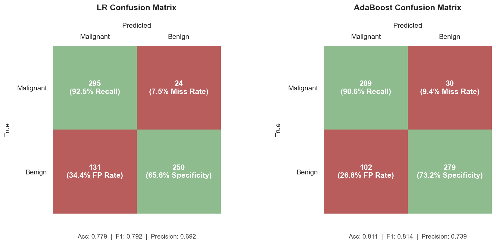

# Breast Cancer Classification

A Python machine-learning project comparing Logistic Regression and AdaBoost for binary classification of breast cancer records as **Benign** or **Malignant**.

The project explores data cleaning, exploratory data analysis (EDA), feature preprocessing, model selection, probability-threshold selection, and evaluation using metrics that show how well the models identify malignant cases.

> **Important:** This is an academic machine-learning project, not a clinically validated diagnostic tool. Its predictions must not be used to make medical decisions.

## Project aims

- Clean and explore a tabular breast-cancer dataset.
- Prepare numeric and categorical features for machine learning.
- Compare Logistic Regression and AdaBoost.
- Prioritise malignant-case recall when selecting a classification threshold, using a target recall floor of 0.90.
- Evaluate models with precision, recall, specificity, F1-score, accuracy, ROC-AUC, and cross-validation results.
- Present findings with clear visualisations.

## Dataset

The repository includes the original and cleaned CSV files:

- `breast_cancer_dataset.csv`
- `cleaned_breast_cancer_dataset.csv`

The original dataset contains 3,620 rows and 20 columns. The cleaned file contains 3,500 rows and 20 columns. The target is `diagnosis`, standardised to `Benign` and `Malignant`; `patient_id` is an identifier and should not be used as a predictive feature.

Before publishing, verify that you are permitted to redistribute the dataset and that it contains no personal or otherwise restricted information. Document the dataset's provenance and licence in `data/README.md` if known.

## Methods

### Data cleaning

`bc_cleaning.py` contains the cleaning and exploratory plotting routines. The supplied cleaned CSV is included so that the modelling workflow can start without repeating the cleaning step.

### Preprocessing

`bc_preprocess.py` defines `FeaturePreparation`. It separates the target and patient identifier, creates a stratified 80/20 train/test split with a fixed random seed, encodes categorical features, and scales numeric features.

### Models and evaluation

`bc_train.py` defines the Logistic Regression and AdaBoost parameter searches. Model selection uses stratified cross-validation and a precision-at-recall-floor scoring function. A decision threshold is then selected to maximise precision while meeting the 0.90 recall target on the training data.

`bc_result_manager.py` calculates test-set metrics and saves model artefacts. `bc_visualiser.py` contains plotting functions for model evaluation. `bc_analysis.py` contains additional EDA and feature-analysis plotting functions.

## Repository layout

```text
.
├── README.md
├── requirements.txt
├── .gitignore
├── bc_cleaning.py
├── bc_preprocess.py
├── bc_train.py
├── bc_result_manager.py
├── bc_visualiser.py
├── bc_analysis.py
├── breast_cancer_dataset.csv
├── cleaned_breast_cancer_dataset.csv
├── data/
│   └── README.md
├── figs/
│   ├── README.md
│   ├── eda/
│   └── results/
├── models/
│   └── README.md
├── results/
│   └── README.md
└── splits/
    └── README.md
```

The folders may contain generated plots, model files, split arrays, and result summaries once the workflow has been run.

## Setup

Use Python 3.10 or newer. From the repository root, create and activate a virtual environment, then install the dependencies:

```bash
python -m venv .venv
source .venv/bin/activate       # macOS/Linux
# .venv\Scripts\activate        # Windows

python -m pip install --upgrade pip
pip install -r requirements.txt
```

## Running the scripts

Run commands from the repository root so the relative file paths used in the scripts resolve correctly.

1. Generate the cleaned dataset, if you want to rerun cleaning. Check the `if __name__ == "__main__"` section in `bc_cleaning.py` for the current entry point and output filename.
2. Prepare the train/test split and transformed feature arrays:

   ```bash
   python bc_preprocess.py
   ```

3. Train and evaluate the models:

   ```bash
   python bc_train.py
   ```

4. Run the EDA or visualisation functions from `bc_analysis.py` and `bc_visualiser.py` as configured in those files.

The scripts currently use relative output paths such as `./splits/`, `./models/`, and `./figs/`. Create these folders before running the relevant scripts if they do not already exist. Some plotting and visualisation calls may need to be enabled or configured in the script entry points.

## Results

The following results are from the final held-out test-set confusion matrices, covering **700 test examples**. Malignant is treated as the positive class.

| Metric | Logistic Regression | AdaBoost |
|---|---:|---:|
| Accuracy | 77.9% | **81.1%** |
| Malignant recall (sensitivity) | **92.5%** | 90.6% |
| Precision | 69.2% | **73.9%** |
| Specificity | 65.6% | **73.2%** |
| F1-score | 0.792 | **0.814** |
| False negatives | 24 | 30 |
| False positives | 131 | 102 |

### Confusion matrices



The two models show a trade-off. Logistic Regression identifies a larger proportion of malignant cases, with 92.5% recall and 24 false negatives. AdaBoost achieves higher accuracy, precision, specificity, and F1-score, with 102 false positives compared with 131 for Logistic Regression. AdaBoost's malignant recall is 90.6%, so it also exceeds the project's 90% recall target in this test result.

These results illustrate why accuracy alone is not enough for this task: missing malignant cases and incorrectly flagging benign cases have different implications. The recall target is an experimental model-selection objective, not a clinical safety guarantee.


## Limitations and next steps

- The dataset and modelling results are not evidence of clinical performance.
- A recall target is a modelling choice, not a guarantee of safe diagnosis.
- Preprocessing should be fitted using training data only. In the supplied version, some cleaning/imputation is performed before the train/test split; review this before treating the reported evaluation as an unbiased estimate.
- The threshold is selected from training predictions after hyperparameter search. A separate validation set or out-of-fold threshold selection would provide a stronger evaluation design.
- Check that the feature names used for EDA, feature selection, and visualisation match the actual transformed feature names.
- Add a reproducible environment, automated tests, and a documented end-to-end run command as the project is refined.

## Disclaimer

For educational and portfolio purposes only. This project is not intended for clinical use and must not be used to diagnose, screen, or guide treatment for any person.
